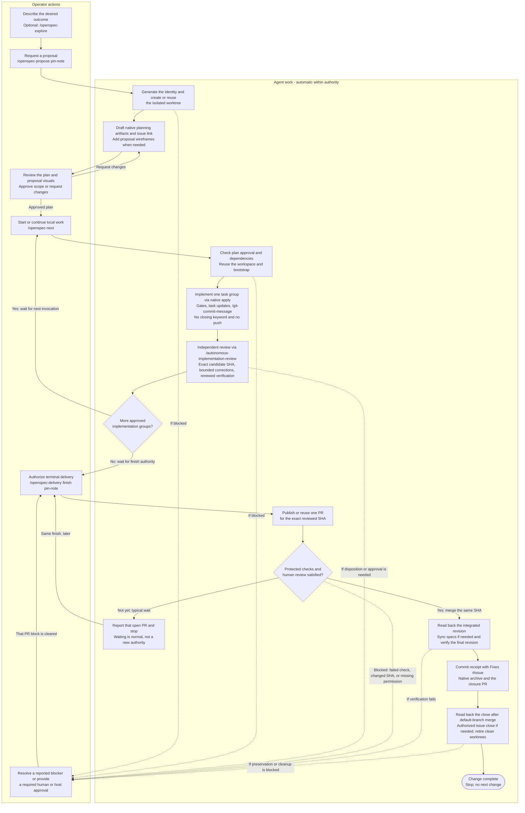

# OpenSpec SDLC

This distribution supports one lifecycle: OpenSpec for specification and task
progress, plus five companion skills for the boundaries OpenSpec does not
enforce. Installing a package does not select the workflow for another project,
transfer that project's records, or grant Git or GitHub authority. Projects that
already keep older records leave those records in place.

OpenSpec's own CLI and native workflows remain a separate prerequisite. This
repository does not vendor them. Use Node 22+, Git and OpenSpec 1.15.0. Review
upstream packages before executing them. Select a profile that contains the
verification workflow (for example Claude's `/opsx:verify`). That workflow is
advisory. It is not an `openspec verify` CLI command and it does not block
archival by itself.

The picture and the field-notes walk-through below are unexecuted examples.
Displaying them grants no Git or GitHub authority.

## Short operator commands

The agent owns the Git plumbing. This project explicitly selects the following
invocation contract; other projects must adopt it in contributor instructions.
Installing skills, displaying examples or approving a plan does not execute it.
Operator restrictions override defaults and remain effective on a bare `next`.

| Request | Agent behavior and authority |
| --- | --- |
| `/openspec-propose add-dark-mode` | Generate the name, prepare/reuse an isolated workspace before native scaffolding, draft the plan and bind the proposal-time issue. No implementation or commits. |
| `/openspec-next` | Resolve the current change and advance one approved unfinished local task group through setup, bootstrap, implementation, gates, independent review, task updates and autonomous local commits with previews. No push/PR/merge. |
| `/openspec-next pin-note` | The same, selecting an unambiguous short slug; no operator-typed ULID. |
| `/openspec-next inspect` | Read-only selection and evidence/approval/dependency assessment. No setup, bootstrap, dispatch or Git writes. |
| `/openspec-delivery pin-note` | The same bounded local continuation as next, for the selected change. |
| `/openspec-delivery prepare pin-note` | Only prepare/reuse and bootstrap its workspace; no implementation, commits or remote writes. |
| `/openspec-delivery finish pin-note` | Separately authorize that change's frozen candidate publication, protected implementation/closure PRs, integrated gates, receipt/archive commits, acceptance-bound issue closure and clean dedicated worktree retirement. |
| `/openspec-delivery document pin-note` | Create/reuse one documentation issue, read it back and bind its URL; no implementation, commits or PR. |

Normally propose, approve the actual plan, then send `/openspec-next`; repeat next
for the next group of the same change. The agent does not stop between worktree
creation, bootstrap, testing and local commits to ask for the same authority
again. It stops for missing approval, ambiguous selection/ownership, failed gates,
review findings needing disposition, unsupported roles, or a new side-effect
boundary. At a reviewed candidate it offers the short `finish` invocation rather
than a paragraph of Git instructions. A bare next never grants remote authority.
With existing finish authority, resume remaining closure steps automatically;
never ask again for each receipt, archive or clean-worktree removal.
A published pull request that is only waiting for review or checks is a normal
pause under that same finish, not a new exception. When the wait ends, resume
with the same finish invocation if that authority is not already held. Read
the actual pull request and continue. Do not open another pull request or
replay merged work. A changed head, failed required check, or missing
protection is the exception: report it, then resume the same finish after it
is cleared. `/git-commit-message` does not push. Implementation commits do
not use a closing keyword. The next push does not close the issue or the pull
request. After acceptance, the receipt commit carries the closeout trailer.
The pull request is merged by the protected route, not by a commit keyword.

A direction change needs only the exception, for example
`/openspec-delivery pin-note group 1 no commits` or
`/openspec-delivery finish pin-note keep the worktree`.
Finish does not approve findings/risk, bypass protection, push the target directly,
force-push, delete branches, release or start another change. Earlier conflicting
restrictions need an explicit change, not silent cancellation. Host/tool approval
controls and reviewer pane-selection requirements remain in force.

The workspace recipe and read-only helper validate canonical paths, exact base,
branch registration, creation/reuse and clean retirement; the orchestrator runs
and verifies their argument arrays. Worktrees isolate the directory/index, not
shared Git refs, services, caches or agent identity. Bootstrap uses the target
project's documented recipe, not invented dependency commands. Existing dirty
work, detached/locked trees, collisions or missing plan ancestry require recovery,
not reset/copy/another ULID. Independent clones remain supported for evidence.
See [workspace](../skills/software-development/openspec-delivery/references/workspace.md)
and [continuation](../skills/software-development/openspec-delivery/references/continuation.md).

The canonical lifecycle package is `openspec-delivery`; `openspec-change-integration`
is no longer distributed. Installed copies are unchanged by source edits. Do not
load old and new lifecycle instructions together. A separate operator-authorized
installation/retirement must preserve local customizations and old hub registration.
The local installer never interprets a new package name as deletion permission;
only its explicit reviewed `--purge` manifest can retire a matching old package,
after preserving the package and matching registration in a backup. No running
shared-profile skill removes itself.

## Lifecycle picture

OpenSpec skills own the change package. The five companion skills own the
boundaries OpenSpec does not enforce. Under the selected metadata policy, an
authorized new proposal includes its documentation issue before approval. A pull
request still needs separate authority. Neither becomes the task list.

An isolated checkout is an agent-managed workspace, not a lifecycle phase or a
manual prerequisite. The operator does not create it: after an authorized proposal
request the agent creates or reuses it before drafting, and later invocations
reuse it. The same applies to bootstrap and authorized clean-worktree retirement.
If ownership, tooling or permissions block that work, the agent reports the
specific decision needed instead of handing the operator a Git checklist.

The two lanes below distinguish **operator actions** from **automatic agent
work within the selected invocation's authority**. Arrows crossing into the
operator lane are decision or authorization checkpoints, not manual setup tasks.
Independent review is `/autonomous-implementation-review` on the exact candidate
SHA. Under `/openspec-next` the agent loads that skill; pane handoff and finding
disposition remain operator checkpoints.



### When the operator acts

| Checkpoint | Operator action | What the agent handles automatically |
| --- | --- | --- |
| Before the first run | Review/install the required tools and skills, select the project workflow, and authorize any host/role configuration. | Inspect the actual project contracts, tooling and configured execution roles; report missing prerequisites. Installation alone does not start work. |
| A new request | Describe the outcome and send `/openspec-propose pin-note`; exploration is optional. | Generate the full name, prepare the isolated workspace, draft native artifacts, bind the authorized proposal-time issue and add proposal wireframes when needed. |
| Plan review | Approve the actual scope/plan or request changes; approval binds the immutable plan revision and digest presented by the agent. | Validate the planning artifacts and present the approval boundary. Approval is not permission to implement. |
| Local implementation | Send `/openspec-next`, or select a change once with `/openspec-next pin-note`. Repeat only when another approved group is ready. | Resolve and execute one task group through setup/bootstrap, implementation, gates, `/autonomous-implementation-review`, task updates and previewed local commits. `/git-commit-message` adds no closing keyword and does not push. No repeated approval for each covered command; no push, PR, merge, or issue close. |
| Terminal delivery | Send `/openspec-delivery finish pin-note` for the reviewed candidate. | Publish or reuse one pull request. If checks or human review are still pending, stop and report it. A later same finish resumes that pull request. Once they are satisfied, integrate through the protected route, verify the integrated revision, perform native sync/archive and receipt/closure work, and verify issue closure and clean-worktree retirement at acceptance. No second pull request and no separate prompts for each covered closeout command. |
| Pull-request wait | Leave the open pull request. When review or checks finish, or a real block is cleared, send the same `/openspec-delivery finish pin-note` only if that authority is not already held. | Read the actual head, checks and reviews. An unchanged reviewed SHA with satisfied protection continues into merge and closeout. Do not open a second pull request, replay implementation, bypass protection, or ask for a different authority. A changed head needs renewed gates and `/autonomous-implementation-review`. |
| An exception | Resolve ambiguous ownership/selection, changed scope, failed verification, findings needing disposition, a pull-request head that changed, missing protection, or host/tool permission prompts when asked. | Preserve work and evidence, state the exact blocker and needed decision, then resume the interrupted step under the retained authority. Do not replay merged work or silently skip a gate. |

The diagram is not a promise of unattended execution: required human PR approvals,
host/tool permission controls and the configured role protocol still apply. In
particular, the current Herdr protocol requires explicit reviewer/executor pane
handoff approval. Routine Git commands are automated; these decisions are not.
Operator restrictions such as `no commits` or `keep the worktree` override the
automatic actions shown. An ordinary `next` never supplies finish authority.

Waiting for protected checks and human review is the normal pause after a pull
request is opened, not an exception and not a failed finish. The agent reports
that pull request and stops. It does not poll unattended, open a second pull
request, or ask for a new kind of authority. There is no scheduler. When the
review lands or a block is cleared in the meantime, the same
`/openspec-delivery finish` resumes from the actual pull request. The return
to finish in the picture is only for that pull-request wait; other blockers
resume the step that reported them. Continue only if that head is still the
reviewed SHA and required checks and reviews are satisfied. A changed head
invalidates the previous review and needs renewed gates and
`/autonomous-implementation-review` before merge. Do not bypass protection,
replay implementation, or merge under `next`. The same pause and same-finish
resume apply to the record-only closure pull request; do not open a second
one while that pull request is waiting.

A local commit is not a close, and `/git-commit-message` does not push.
Implementation commits and the implementation pull-request body do not use
`Fixes`, `Closes` or `Resolves` while later acceptance is still required. The
next push does not close the documentation issue or the pull request. After
acceptance is verified, the receipt commit carries `Fixes #<issue>` for the
verified documentation issue and `Closes #<pull-request>` only for a pull
request already read back as merged. An open pull request is named without a
closing keyword, because that keyword would close it without merging once the
commit reaches the default branch. The closure pull-request body repeats
`Fixes #<issue>`. GitHub applies the keyword only when that commit is merged
into the repository default branch. If the closure pull request targets
another branch, or readback shows the issue still open, finish performs the
authorized documentation close and reads it back. Archival does not close the
issue, and closing it does not archive the change.

Parallel changes are two of these pictures at once, in separate checkouts.
They share neither an index nor a `tasks.md`. A parent issue may list both
links. It does not own either task list.

Host spelling differs. The pinned OpenSpec docs use `/opsx:propose` as the
canonical command. Hermes loads the same action as `/openspec-propose`.
`/openspec-apply-change` is the skill exposed as `/opsx:apply` in that command
spelling. Do not assume one spelling works in every host.

Core profile, which this document assumes:

| Action | Skill | Command name in the OpenSpec docs |
| --- | --- | --- |
| Think before a plan | `/openspec-explore` | `/opsx:explore` |
| Create the change and its planning artifacts | `/openspec-propose` | `/opsx:propose` |
| Revise planning artifacts | `/openspec-update-change` | `/opsx:update` |
| Implement tasks | `/openspec-apply-change` | `/opsx:apply` |
| Merge accepted delta specs into current specs | `/openspec-sync-specs` | `/opsx:sync` |
| Move the finished change to the archive | `/openspec-archive-change` | `/opsx:archive` |

`/openspec-verify-change` (`/opsx:verify`) is an expanded-profile check. It is
advisory. It does not replace project gates and it does not archive.

## Identity and path conventions

The full change name is the stable reference in tickets, dependencies, handoffs
and other documents. For example, cite `pin-note-01arz3ndektsv4rrffq69g5fav`, or
`proposal of pin-note-01arz3ndektsv4rrffq69g5fav` when the artifact matters. Do not
embed its active directory as the durable reference. The archive keeps the same
identity; the date prefix belongs to the storage directory, not the change name.
For cross-project references, include the repository identity as well.

Names do not automatically become clickable links. An agent resolves the name
against the selected checkout before using filesystem tools. The packaged naming
helper resolves active changes only; for historical work, inspect dated archive
directories for that exact name and reject ambiguous or duplicate locations.
An active lookup miss is not permission to create a replacement change. Dataview
can query the unchanged `change` field and generate the link to its current file.
Bare `[[proposal]]` links are ambiguous because many changes use that filename.

The following are layout patterns for tool use, not cross-document identities.
Unless explicitly labeled distribution source, they are relative to the adopting
project's root. `<name>` means the full existing change name; `<capability>` is
the capability's stable key, which may contain nested path segments.

| Owner | Location pattern | Meaning |
| --- | --- | --- |
| Native OpenSpec | `openspec/config.yaml` | Selected project configuration |
| Native OpenSpec | `openspec/changes/<name>/.openspec.yaml` | Change metadata |
| Native OpenSpec | `openspec/changes/<name>/proposal.md`, `design.md`, `tasks.md` | Change-owned artifacts; bare filenames here share that package root |
| Native OpenSpec | `openspec/changes/<name>/specs/<capability>/spec.md` | Proposed requirement delta, not the current spec |
| Native OpenSpec | `openspec/specs/<capability>/spec.md` | Current capability behavior |
| Native OpenSpec | `openspec/changes/archive/YYYY-MM-DD-<name>/` | Archived package, with its internal layout preserved |
| Companion convention | `wireframes/` within the selected change package | Review-only proposal assets, if that project selects this subdirectory |
| Companion convention | `docs/product/wireframes/` | Current visual generator and output root; not an OpenSpec requirement |
| Companion convention | `evidence/` within the selected change package | Git-tracked integration evidence; moves with the package |
| Git ref, not a directory | `change/<full-name>` | Branch naming convention; not an artifact location |

Project-local visual layouts win over the companion's default. This distribution
ships the playbook, not a field-notes product tree or a ready-made screen generator.
Support-file links in this document resolve relative to this document. A skill's
`references/` and `scripts/` resolve relative to that installed skill package,
not the target repository or an assumed agent-profile path.

Use package-relative links only when source and target move together, such as a
proposal linking its own wireframe. For references outside that package, use the
full change name plus artifact role, or an optional verified immutable commit
permalink for a specific published revision. Do not use a guessed future archive
path, and do not push merely to obtain a URL. Before syncing a delta into a current
spec, resolve visual references by stable capability/screen key and write links
relative to the current spec's location; a copied delta-relative link has a
different base. Fix links before final verification, not by editing a frozen
archive. Link edits inside approved planning files require reapproval, just like
other planning edits. The receipt guard permits only byte-identical package movement.

## Change names and branches

The operator supplies a readable slug, not an identifier:

```text
/openspec-propose add-dark-mode
```

Before scaffolding, the agent automatically generates one lowercase ULID and
uses `<slug>-<ulid>` as the full OpenSpec change name. For example, the following
is a synthetic identity, not a command to create work:

```text
Name:   add-dark-mode-01arz3ndektsv4rrffq69g5fav
Branch: change/add-dark-mode-01arz3ndektsv4rrffq69g5fav
```

The branch convention is `change/<full-name>`. Keep the same branch through
specification, implementation and review; do not add phase numbers, developer
names, or status prefixes. Naming alone does not authorize branch creation;
the selected proposal/delivery invocation supplies bounded setup authority. Check
existing local/remote branches and worktrees before an authorized creation;
reuse the confirmed branch or stop on conflicting ownership, never reset it.

The full name stays immutable even if the proposal title changes. Reuse it for
issues, pull requests, evidence, handoffs and retries. Do not generate a second
ULID for those actions. Collaborators on one change share its identity and
coordinate writers; independently created changes receive different identities.
Existing change names and branches remain unchanged; no bulk rename is required.

On resume, use an explicitly selected existing change or verified current change
context. A short slug resolves only if unambiguous. If multiple packages match,
show their full names and proposal summaries and ask the operator to select one.
Never choose the newest automatically. No match is an error on resume, not
permission to create another change. An explicitly new proposal may share a
slug, but first inspect visible matching requests to avoid duplicating work.
Unique names do not eliminate overlapping-spec reconciliation or acquire a lock.

This is project policy, not stock OpenSpec behavior. The root `AGENTS.md` directs
the agent to the packaged [naming procedure](../skills/software-development/openspec-delivery/references/naming.md)
before `openspec new change`. The helper generates/resolves names without writes;
OpenSpec still owns proposal scaffolding. Config artifact instructions alone
are not a pre-creation hook. Other projects must explicitly adopt the same rule
in their contributor instructions; installation alone does not activate it.
Do not patch installed adapters or add another propose skill.

## Demo: field-notes

`field-notes` is a synthetic notes application. It is not this repository, and
the issue and pull-request numbers below are placeholders. Do not create them
unless the operator of that project asks.

The narrative uses short labels for readability. Durable references and later
commands use the full identity, not a moving directory. The suffixes below are synthetic examples;
actual proposals receive freshly generated ULIDs. Existing unsuffixed packages
remain valid and are not renamed.

The operator wants two deliveries that can be specified at the same time:

| Label | Full change name | What it is | Depends on |
| --- | --- | --- | --- |
| `pin-note` | `pin-note-01arz3ndektsv4rrffq69g5fav` | A person can pin one note from the note screen | nothing |
| `export-notes` | `export-notes-01arz3ndektsv4rrffq69g5faw` | A command writes the notes to a file | nothing |
| `pin-note-sync` | `pin-note-sync-01arz3ndektsv4rrffq69g5fax` | A second device receives the pin | integrated `pin-note` |

`pin-note` and `export-notes` are parallel. `pin-note-sync` may be specified
immediately, against the `pin-note` proposal, but its implementation waits for
the accepted integrated revision of `pin-note`. A closed issue is not that
revision.

### Specify `pin-note`

The operator asks to explore the pin interaction, then to propose it.

```text
/opsx:explore
/opsx:propose pin-note
```

On Hermes those are `/openspec-explore` (`/opsx:explore`) and `/openspec-propose`
(`/opsx:propose`). The selected project policy generates the suffix first. The
propose workflow creates change `pin-note-01arz3ndektsv4rrffq69g5fav` and writes
its proposal, delta spec, design, and `tasks.md`. The selected proposal policy includes one
documentation issue; without that bounded authority the link remains pending.
The agent prepares its isolated workspace before scaffolding. Planning does not
authorize implementation, a commit, or a pull request.

The note screen is a primary human-facing surface. The operator asks for a
wireframe with a prompt, which loads `/capability-wireframes`:

```text
/capability-wireframes
Draft a proposal wireframe for the note screen of change pin-note-01arz3ndektsv4rrffq69g5fav.
Keep it in the change package. Do not update the product manifest.
```

The proposal visual belongs to `pin-note-01arz3ndektsv4rrffq69g5fav`, outside the
current-product manifest. Its local HTML/PNG links move with that package. Refer
to it elsewhere by the full change name and screen key, not its current directory.

For this example, the capability key is `notes` and the screen key is
`note-screen`. They describe the long-lived product surface, not a change or a
directory. When the project selects the companion's default layout, the concrete
current files are:

| Artifact | Project-root-relative location |
| --- | --- |
| Editable current-screen definition | `docs/product/wireframes/generate.mjs` |
| Generated current inventory | `docs/product/wireframes/manifest.json` |
| Generated current index | `docs/product/wireframes/index.html` |
| Generated HTML for this screen | `docs/product/wireframes/notes/html/note-screen.html` |
| PNG rendered from that HTML | `docs/product/wireframes/notes/exports/note-screen.png` |
| Current capability spec | `openspec/specs/notes/spec.md` |

These current-product paths do not move when a change is archived. They are not
proposal destinations and are not claimed to exist in this distribution. During
implementation, update the generator and render its outputs; do not promote a
proposal by moving it into the product directory. Link the actual HTML/PNG from
the current spec, relative to that spec, and validate the resolved targets.
A directory is not an HTML page, and a manifest key is not automatically a
clickable URL. A later change to this screen reuses the same stable keys.

The selected proposal policy creates or reuses one documentation issue during
the authorized proposal, then records its verified URL in proposal frontmatter
before approval. The operator does not repeat the ticket rules. For an existing
draft with a pending link, this separately authorized invocation completes only
the documentation step:

```text
/openspec-delivery document pin-note-01arz3ndektsv4rrffq69g5fav
```

`/openspec-delivery` applies the proposal-time risk-focused body and
identifies `pin-note-01arz3ndektsv4rrffq69g5fav` by its full name. It reads back
the issue and binds its verified URL in the proposal when authorized, then stops. It does not
generate another suffix, copy `tasks.md`, implement, commit, open a pull request, or
assign the issue to lock the work.

The body is the packaged [ticket template](../skills/software-development/openspec-delivery/references/ticket.md)
(this link points to distribution source, not a file expected in field-notes).
It records request, blast radius, confidentiality, integrity, availability,
authorization and recovery. That supports change-control evidence. It does not
establish ISO/IEC 27001 conformity. Do not label the issue compliant.

The full OpenSpec change name is the identity. It correlates the issue, the pull
request and the evidence. Reuse it exactly. If `export-notes` is a
different request, it gets its own change name in its own checkout. If another
clone is already editing `openspec/specs/notes/spec.md`, stop and reconcile. A
new name is not permission to continue.

Do not paste the task list into the issue. A second session that sees the
issue unassigned has not acquired a lock.

`export-notes` is specified the same way in another checkout, with
`openspec-propose` and its own `tasks.md`. It does not edit the pin-note
working tree. If both changes are documented, a parent issue may link the two
child issues. The parent is a group label, not a third plan.

### Implement one task group

The operator has approved the plan and wants the next local group. They send:

```text
/openspec-next pin-note
```

It resolves the existing full name, confirms recovery, prepares/reuses and
bootstraps the dedicated worktree, and refuses a second writer for that change.
It selects task group 1 from the actual tasks and approval, not this example.
The branch is `change/pin-note-01arz3ndektsv4rrffq69g5fav`.
Keep it through specification, implementation and review.

The implementer follows `/openspec-apply-change` (`/opsx:apply`) for that
group and reports commands, paths, and results. The orchestrator checks the
matching boxes in `tasks.md` only after verifying that implementation evidence.
Include those ticks in the final frozen commit before independent review; a later
checkbox commit needs renewed review. Stock apply must not tick those boxes itself.

Commits use `/git-commit-message`: preview the exact batch, verify its staged
content and commit automatically under the selected local execution contract.
No extra confirmation is required unless the operator restricts commit authority. The implementation batch does not include a
later evidence file or the issue text.

Before a pull request may be merged, and before its branch may be deleted, a
reviewer that did not implement the candidate must review that exact SHA.
The operator starts that review with `/autonomous-implementation-review`:

```text
/autonomous-implementation-review
Review only candidate abc1111 of change pin-note-01arz3ndektsv4rrffq69g5fav.
Use a reviewer session and model that did not implement this candidate.
Read-only. Do not merge the pull request and do not delete the branch.
```

The loop stops after the named group. It does not open a pull request and it
does not start `export-notes`. If no different reviewer can run, stop. The
implementer must not review its own candidate.

### Review on a pull request

When the candidate is a clean commit, for example `abc1111`, and the operator
asks for review, open a pull request whose body names that SHA and the change:

```text
Title: Pin a note
Body:  Change: pin-note-01arz3ndektsv4rrffq69g5fav
       Candidate: abc1111
       Documents: https://github.com/example/field-notes/issues/40
```

The pull request is the review record of `abc1111`. It is not a copy of
`tasks.md`. If the candidate becomes `def2222`, the previous review does not
count. Do not put a closing keyword in an implementation commit or in the
implementation pull-request body while later acceptance is still required.
The next push does not close the issue or the pull request. The receipt
commit, after acceptance, carries the closeout trailer.

`/openspec-delivery` then uses its read-only guard. The review record
cites issue 40 because the operator already created that documentation issue.
The citation is not a reason to create an issue, and the guard does not call
GitHub.

Terminal delivery is one short authorization after the independent verdict on
the actual frozen SHA and disposition of every finding. It includes protected
publication/integration and verified closeout, not repeated prompts for plumbing:

```text
/openspec-delivery finish pin-note
```

The agent verifies the bound candidate and actual repository/target first. If
that pull request is still waiting on review or checks, stop and report it.
That wait is typical. When it is later satisfied for the same SHA, send the
same finish again if that authority is not already held. The agent reads that
pull request and continues. It does not open another. A changed head or a
failed required check is the exception; resume the same finish only after it
is cleared. Branch
deletion remains excluded unless separately authorized; clean dedicated worktree
retirement is included after verified closure. One change retains its implementation
branch through review. Integrated verification uses an exact-revision isolated tree;
record-only closure uses `closure/<full-name>` from the verified target and its own
protected PR. These are the same change, not additional task trackers.

### Integrate, sync, archive

The finish invocation supplies integration and terminal-closeout authority.
The agent continues automatically: read back the merge and the containing
target revision. Run the project's required gates on that named revision and
keep the output. A failed gate keeps the change open. It does not close issue
40, and it does not mean the merge should be replayed.

Before closing the change:

1. `/openspec-sync-specs` (`/opsx:sync`) updates the current `notes` capability spec only if the
   delta is not already there. Do not reapply a delta over a newer spec. Add the
   project-owned `spec`/capability frontmatter to a newly created current spec;
   keep deltas frontmatter-free and validate links from their final document base.
   Run the target project's metadata check and `openspec validate --all --strict`.
   `npm run validate:openspec` is this distribution's check, not a script installed
   into field-notes by copying a skill.
2. If spec sync, metadata or link correction changed the integrated tree, obtain
   the authorized integrated revision and re-run required gates on it before
   recording the receipt. `/git-commit-message` commits the factual receipt as
   its own authorized batch; it names that actually verified revision.
3. `/openspec-archive-change` (`/opsx:archive`) moves the completed package into
   the dated archive layout. Continue referring to it as
   `pin-note-01arz3ndektsv4rrffq69g5fav`; no cross-document path rewrite is needed.
   Verify byte-identical movement and re-run metadata/upstream checks. Current
   specs must already be correct for a record-only archive; use native
   `--skip-specs` only for that verified case. If archival needs further spec or
   link changes, stop the record-only closure and return to integrated verification.
4. Close issue 40 only if the operator authorizes that documentation write and
   the declared acceptance boundary is met. Archival does not close it.
   Closing it does not archive the change.

`export-notes` continues in its own checkout through the same picture. It does
not wait for issue 40. `pin-note-sync` may now be implemented, because the
integrated revision of `pin-note` exists. Its specification did not need to
wait for that revision, and it still does not share `pin-note`'s `tasks.md`.

If `pin-note` and another active change both edit `openspec/specs/notes/spec.md`,
stop before either merges and reconcile the overlap. A clean Git merge of the
two files is not combined-system evidence.

## Authorities

| Concern | Authority |
| --- | --- |
| Current behavior | `openspec/specs/<capability>/spec.md`, backed by code and tests |
| Proposed scope and behavior | Proposal and delta specs of the selected full change name |
| Technical approach | Change-owned `design.md` where needed |
| Implementation progress | Change-owned `tasks.md`, written only by the orchestrator |
| Specification actions | OpenSpec propose, apply, sync and archive |
| Commits | `/git-commit-message`; no push. No closing keyword before acceptance. The receipt commit carries the closeout trailer. |
| Human-facing visuals | `/capability-wireframes` |
| Independent review before merge | `/autonomous-implementation-review` |
| Workspace lifecycle, candidate identity, recovery and integrated evidence | `/openspec-delivery` |
| Grounded next task group and bounded continuation | `/openspec-next` |
| Documentation and human review | Proposal-time issue under explicit project policy; PR and later updates separately authorized |

One concern has one authority. `tasks.md` is the only mutable task list. An
issue is not a second plan. A pull request is not a progress file. A checked
task is implementation progress, not a merged or deployed result.

A change is one independently mergeable delivery. A larger feature is several
changes. A parent issue may group them as documentation. Each change keeps its
own identity, scope, gates and acceptance boundary.

## What each skill adds

OpenSpec does not commit, isolate writers, bind review to an exact candidate,
or keep a visual identity across archival. Its collaboration rules are
convention, not enforcement.

- `/openspec-delivery` is the orchestrator boundary: one writer, an
  isolated checkout, candidate and plan identity, recovery, and Git-tracked
  evidence after integrated verification. It is not a scheduler and not a
  GitHub client. Its short invocation owns setup/bootstrap, local execution and
  bounded finish; the operator supplies exceptions, not a Git recipe.
- `/openspec-next` finds the actual approved unfinished group and advances it
  under the selected local policy; inspect mode performs no mutations.
- `/git-commit-message` keeps logical batches, a preview, exact staging and
  separate commit authority. It does not push. Implementation commits omit
  closing keywords. The receipt commit, after acceptance, carries
  `Fixes #<issue>` and names already-merged pull requests with `Closes`. A project-selected execution invocation explicitly
  enables autonomous local commits; the orchestrator role alone does not.
- `/capability-wireframes` keeps a stable screen key and a generated HTML/PNG
  review. Proposal images stay change-owned. They are not current behavior.
- `/autonomous-implementation-review` is the independent reviewer. It must be a
  different session and model from the implementer. Its verdict on the exact
  SHA is required before that pull request is merged and before the branch is
  deleted. It does not select the next change, accept risk, or approve the
  GitHub review.

No skill in this set replaces OpenSpec propose, apply or archive. Stock apply
may tick checkboxes; the orchestrator mediates that write. The implementer
reports evidence and does not edit `tasks.md`.

## Parallel specification

Independent changes may be specified and implemented at the same time.

1. Each change gets its own OpenSpec package and its own checkout. Changes do
   not share an index, working directory or mutable test environment.
2. One operator-designated orchestrator owns each change. Starts and handoffs
   for that change are operator-serialized. Two sessions that both observe no
   active run have not acquired a lock. Comments, assignees and refs only show
   a conflict that was already observed.
3. A dependent change may be specified before its prerequisite is integrated.
   Its implementation waits for the prerequisite's accepted integrated revision,
   not for a checked task or a closed issue.
4. Two changes that edit the same capability spec must reconcile that overlap
   before either merges. Record the source revision they were specified against.
   A later rebase does not silently redefine that baseline. A clean Git merge
   is not combined-system evidence.
5. One implementation writer per change. Parallelism is across changes, not
   across writers inside one change.

## Documentation and review

GitHub is the documentation and review surface. It is not the specification
system and not an execution lock.

- During an authorized new proposal, create or reuse one documentation issue
  under the explicitly selected proposal-time policy. Read it back and record
  its URL before plan approval. Offline or unauthorized drafts use a null link
  and remain pending. Later issue updates need separate authority. Link the
  OpenSpec change. Do not copy `tasks.md` into the issue or invent a ticket.
- Open a pull request only when the operator asks to review or integrate a
  frozen candidate. The review binds the exact commit, not the evolving request
  body. A changed candidate invalidates review.
- Closing an issue does not archive a change. Archiving a change does not close
  an issue unless that documentation write is separately authorized.
- Protected checks and a merge queue, where the project uses them, are
  repository settings. This package neither creates nor proves them. If they
  are missing, stop. Do not change protection to make a pull request mergeable.
- The helper's review and receipt commands cite a documentation issue URL when
  those evidence records are produced. That citation is not permission to
  specify, and it is not a reason to create an issue.

## Integration and completion

1. Refresh against the current target and shared capability specs. Reconcile
   overlaps. Include implemented behavior, tests, specs and current visuals
   together.
2. Integrate only with explicit authority. Read back the exact result and the
   containing target revision. Squash or rebase mapping is unsupported by the
   packaged guard; do not weaken that check to force a merge style.
3. Run the required acceptance gates on a named integrated revision. Retain the
   commands, environment, exit statuses and output. Failure blocks completion
   and needs an explicit repair or revert decision. Never replay an already
   merged implementation.
4. After successful integrated verification, commit the factual receipt and
   archive the change. Do not reapply delta specs that are already in current
   specs. A receipt names completed verification. It does not predict the merge
   of the commit that contains it.
5. Under finish authority, verify issue acceptance/closure and retire clean dedicated
   worktrees automatically unless the operator retains them. Stop at the authorized
   change. No next change, release or branch deletion is implied.

Planning permission ends at the requested artifacts and the bounded proposal-time
issue write when explicitly selected by project policy. Approval of a plan is not
permission to implement, commit, open a pull request or merge.

## Metadata and vault views

Follow [OpenSpec metadata and Obsidian](openspec-metadata.md) for identity-only
YAML frontmatter, one stable `github_issue` on the proposal, validation commands
and same-files vault integration. No PR list or progress properties are stored.
Metadata stays covered by the plan digest; corrections after approval require
reapproval. Archive moves retain the change identity. Current specs use their
capability identity, not the originating change. A Dataview dashboard is a view,
not another task authority or proof of client filesystem synchronization.

## Guard

`/openspec-delivery` ships the read-only package-relative `scripts/change-guard.mjs`
helper. Its [guard](../skills/software-development/openspec-delivery/references/guard.md),
[integration](../skills/software-development/openspec-delivery/references/integration.md)
and [recovery](../skills/software-development/openspec-delivery/references/recovery.md)
references own the commands and recovery table.

The helper validates committed identities, plan continuity, review binding and
receipt structure. It does not authenticate a reviewer, discover every required
gate, execute tests, call GitHub, acquire a lock or authorize a write. Full
object IDs must already be local. Independent clones are supported. Preserve
dirty work and uncertain API outcomes. Read back before retrying a write.

## Packages

| Plugin | Skills |
| --- | --- |
| `openspec-development` | `/openspec-delivery`, `/openspec-next`, `/git-commit-message`, `/capability-wireframes` |
| `autonomous-orchestration` | `/autonomous-implementation-review` |

Orchestration is optional. It requires the workflow plugin, explicit role and
model configuration, and a supported host. Package installation does not create
those roles.

## Verification

Run `npm test` and `npm run build`. Tests cover Git fixtures, package inventories
and native-copy collision safety. Artifact validation does not prove model
execution, protected integration or deployment acceptance. Publication, live
issues, protection settings and installed profiles need separate authorization.

## References

Local authority is defined above, not attributed to upstream:

- [OpenSpec team workflow](https://github.com/Fission-AI/OpenSpec/blob/6d04a1b58dedc95729d34e4f223d9d483aae210a/docs/team-workflow.md)
- [OpenSpec actions](https://github.com/Fission-AI/OpenSpec/blob/6d04a1b58dedc95729d34e4f223d9d483aae210a/docs/workflows.md)
- [OpenSpec verification](https://github.com/Fission-AI/OpenSpec/blob/6d04a1b58dedc95729d34e4f223d9d483aae210a/docs/reviewing-changes.md)
- [OpenSpec configuration](https://github.com/Fission-AI/OpenSpec/blob/6d04a1b58dedc95729d34e4f223d9d483aae210a/docs/customization.md)
